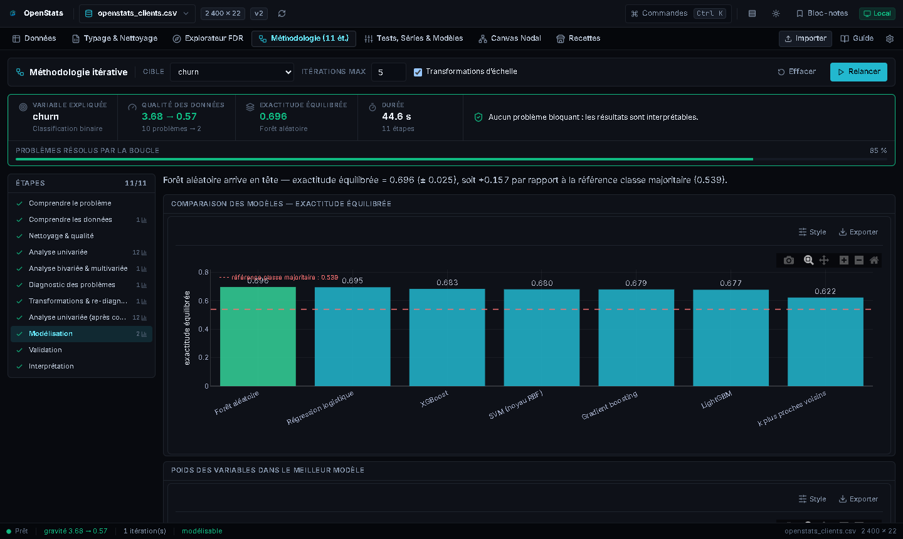
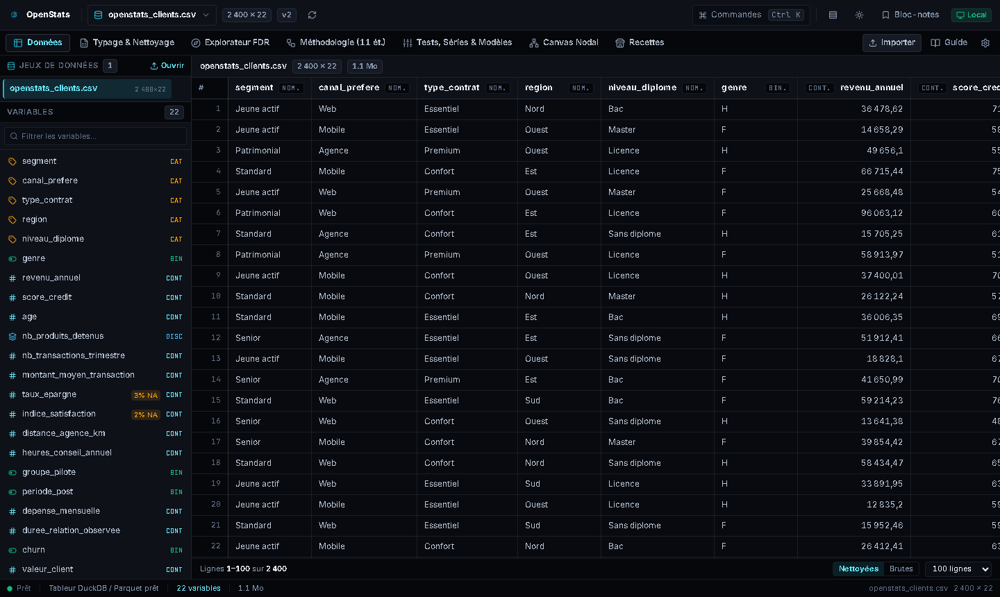
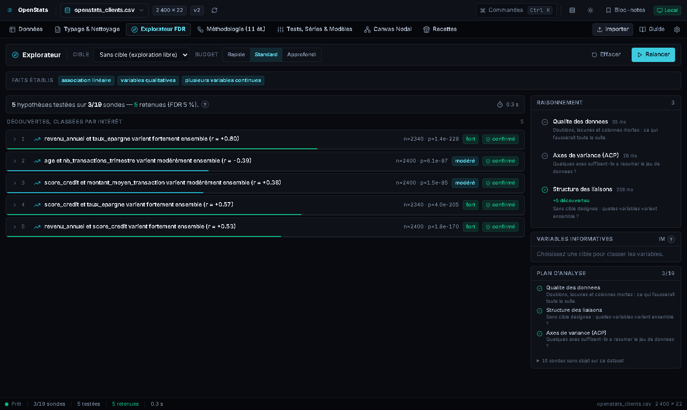
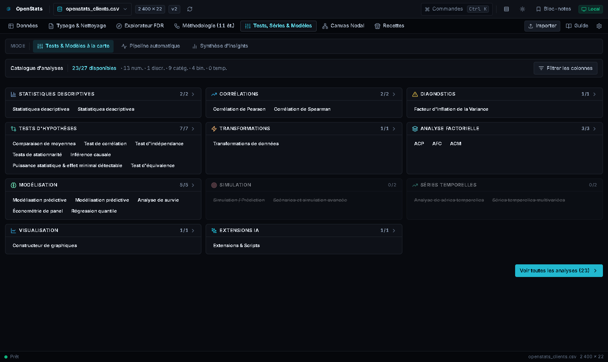
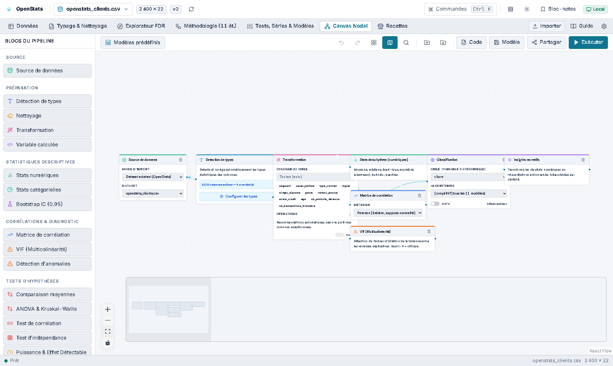

<div align="center">

# OpenStats

**Plateforme d'analyse statistique, d'économétrie et de Machine Learning 100 % locale.**  
*Aucun cloud imposé. Moteur DuckDB. Graphiques prêts pour publication. Export Python, R & Jupyter.*

[](README.md)
[](README.fr.md)
[](https://github.com/elm-as/OpenStats/releases/tag/v1.0.0-rc.2)
[](https://github.com/elm-as/OpenStats/releases/latest)
[](#licence)

[**Télécharger l'installeur Windows (`OpenStats_Setup_v1.0.0-rc.2.exe`)**](https://github.com/elm-as/OpenStats/releases/latest) · [**Guide Utilisateur**](docs/USER_GUIDE.md) · [**Architecture Technique**](docs/TECHNICAL_ARCHITECTURE.md)

<br/>



</div>

---

## Pourquoi choisir OpenStats ?

Là où la plupart des outils imposent de choisir entre simplicité visuelle (SPSS, Jamovi) et profondeur analytique (Python, R), **OpenStats réunit les deux en local sur votre machine — sans compte ni télémétrie.**

- **Méthodologie itérative autocorrectrice (11 étapes)** — Diagnostique asymétrie, valeurs extrêmes et manquantes, teste les remèdes, **annule automatiquement toute correction sans gain réel**, et compare 15 modèles ML + 6 prévisionnistes à une **référence naïve**.
- **Statistiques honnêtes (contrôle FDR)** — L'Explorateur Adaptatif applique la correction de **Benjamini-Hochberg à 5 %** sur l'ensemble de la session et affiche le nombre exact d'hypothèses testées.
- **Graphiques de niveau publication (Clair & Sombre)** — Palette accessible Okabe-Ito, Forest Plots (`coefplot` β ± IC 95 %), courbes de survie Kaplan-Meier, Love Plots, grilles IRF/FEVD et exports HD PNG (`3×`) / SVG / CSV.
- **Du Visuel au Code Reproductible** — Assemblez vos flux SQL DuckDB, nettoyages et modèles sur le Canvas Nodal, puis exportez en un clic vers **Python (`.py`)**, **R (`.R`)**, **Jupyter (`.ipynb`)**, **PDF**, **DOCX** ou **PPTX**.
- **Application Desktop Windows Autonome** — Un seul installeur (`OpenStats_Setup_v1.0.0-rc.2.exe`) embarquant Python, DuckDB, Scikit-Learn, XGBoost, LightGBM, Statsmodels et SHAP sans prérequis système.

---

## Aperçu de l'interface

<table>
  <tr>
    <td width="50%">
      
      <p align="center"><b>Établi Données</b> — Grille DuckDB/Parquet, dock des variables, typage sémantique et historique de versions.</p>
    </td>
    <td width="50%">
      
      <p align="center"><b>Explorateur Adaptatif</b> — Sondes guidées par l'information mutuelle avec décompte transparent du FDR 5 %.</p>
    </td>
  </tr>
  <tr>
    <td width="50%">
      
      <p align="center"><b>Atelier Statistique & Économétrie</b> — Tests d'hypothèses, TOST, puissance, OLS/Panel/Quantile, ACP/AFC/ACM, ARIMA/VAR.</p>
    </td>
    <td width="50%">
      
      <p align="center"><b>Canvas Nodal (Clair & Sombre)</b> — Pipelines analytiques visuels avec export direct en script Python, R ou Notebook.</p>
    </td>
  </tr>
</table>

---

## Couverture analytique

| Domaine | Fonctionnalités |
|---|---|
| **Données & SQL** | CSV, Excel multi-feuilles, JSON/JSONL, Parquet (validation *magic bytes*), **SQL DuckDB** intégré, versionnement des jeux de données |
| **Tests & Puissance** | Shapiro-Wilk, Student/Welch, Mann-Whitney, ANOVA, Kruskal-Wallis, Tukey HSD, Games-Howell, Khi-2, Fisher, **équivalence TOST**, **puissance & MDE** |
| **Économétrie & Causalité** | OLS robuste (HC1/HC3), VIF & diagnostics résiduels, régression quantile, Poisson / Binomiale Nég., **Panel FE/RE + Hausman**, **Kaplan-Meier & Cox**, **PSM + Love Plot, DiD, 2SLS** |
| **Séries Temporelles** | ADF/KPSS, décomposition saisonnière, **ARIMA, SARIMA, Prophet, Holt-Winters**, **VAR, VECM, ARDL, BVAR, Johansen, Granger, IRF & FEVD** |
| **Factoriel & ML** | ACP, AFC, ACM (biplots, cercles de corrélation), 15 modèles supervisés, K-Means/DBSCAN, **explicabilité SHAP**, Monte Carlo & Bootstrap |
| **Exports & Rapports** | Scripts autonomes **Python (`.py`)**, **R (`.R`)**, **Jupyter (`.ipynb`)**, rapports **PDF (ReportLab)**, **Word (DOCX)**, **PowerPoint (PPTX)**, **Excel** |

---

## Démarrage rapide

### Option 1 — Installeur Windows autonome (Recommandé)

Téléchargez et lancez **`OpenStats_Setup_v1.0.0-rc.2.exe`** depuis [**GitHub Releases**](https://github.com/elm-as/OpenStats/releases/latest). Aucun prérequis Python ou Node.js requis.

### Option 2 — Lancer depuis les sources

```bash
git clone https://github.com/elm-as/OpenStats.git && cd OpenStats

# Terminal 1 — Backend analytique Python (Python 3.10+)
cd backend && python -m venv venv && venv\Scripts\activate
pip install -r requirements.txt && python run.py

# Terminal 2 — Frontend React + Vite (Node 18+)
cd frontend && npm install && npm run dev
```

<details>
<summary><b>Compiler l'installeur Desktop et lancer les suites de tests</b></summary>

```bash
# Compilation complète PyInstaller + Electron + Inno Setup -> frontend/release/OpenStats_Setup_v1.0.0-rc.2.exe
python scripts/build_installer.py --rebuild-backend

# Validation qualité & tests
cd backend && python -m pytest tests -p no:qt -q
cd frontend && npx tsc -b && npx vitest run
python scripts/check_line_counts.py   # Audit strict ElmasCore <= 350 lignes/fichier
```

</details>

---

## Garanties statistiques & portée

OpenStats documente explicitement ce qui est vérifié par tests automatisés et ses limites d'utilisation (détails complets dans [`ARCHITECTURE.md`](ARCHITECTURE.md)) :

| Garantie / Limite | Statut |
|---|---|
| **Annulation des corrections sans gain** | Vérifiée : toute remédiation inefficace ou dégradante est annulée automatiquement |
| **Protection de la variable cible** | Garde-fou strict à la sélection et lors de l'application des remèdes |
| **Comparaison à une référence naïve** | Aucun score ML ou prévisionniste n'est présenté sans sa baseline |
| **Zéro erreur avalée** | 61 tests AST interdisent `except Exception` silencieux (`statistical_attempt.py`) |
| **Périmètre d'exécution local** | Le nœud Python exécute en `exec()` local : conçu pour un poste individuel, non exposé en multi-tenant |
| **Parité du code exporté** | Scripts Python exécutés en sous-processus sur 26 types de nœuds (écart max `8,88e-16`) ; R validé structurellement |

---

<details>
<summary><b>Documentation & Charte d'ingénierie ElmasCore</b></summary>

- [**Guide Utilisateur (`docs/USER_GUIDE.md`)**](docs/USER_GUIDE.md) — Manuel complet des workspaces et méthodes statistiques
- [**Architecture Technique (`docs/TECHNICAL_ARCHITECTURE.md`)**](docs/TECHNICAL_ARCHITECTURE.md) — IPC, jetons de session, DuckDB zero-copy, chaîne PyInstaller/Inno Setup
- [**Guide Desktop (`DESKTOP_GUIDE.md`)**](DESKTOP_GUIDE.md) — Compilation de l'installeur Windows
- [**Moteurs d'analyse (`ARCHITECTURE.md`)**](ARCHITECTURE.md) & [**Charte (`ELMAS.md`)**](ELMAS.md) — Découpage par domaine et plafond strict à 350 lignes

</details>

## Licence

Distribué sous licence **AGPLv3** — *local-first*, open-source, sans compte obligatoire ni envoi de vos données vers le cloud.

<div align="center">
  <sub><b>ELMAS CORE LABORATORY</b> — <i>« From Data to Systems »</i></sub>
</div>
