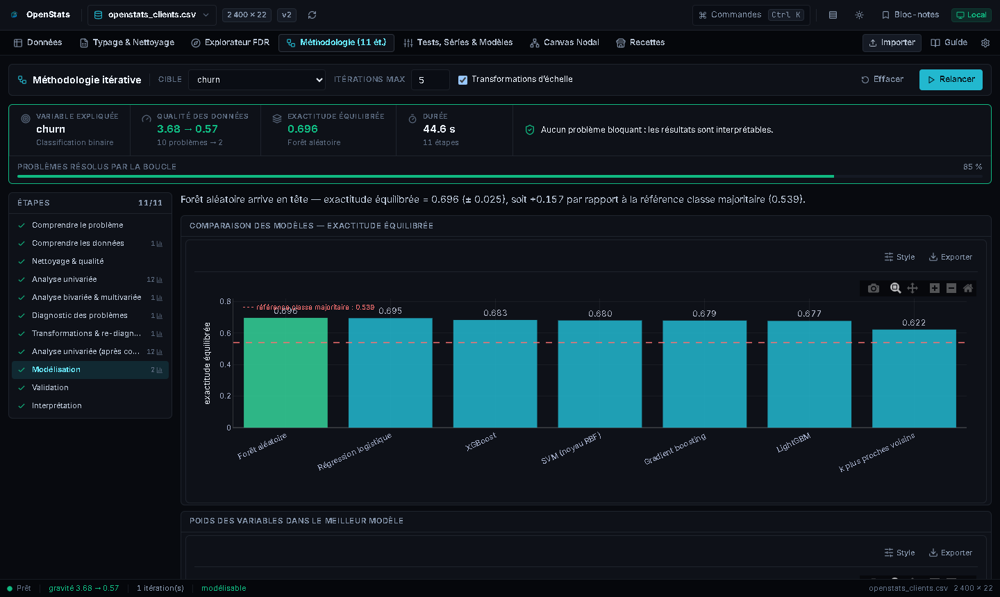
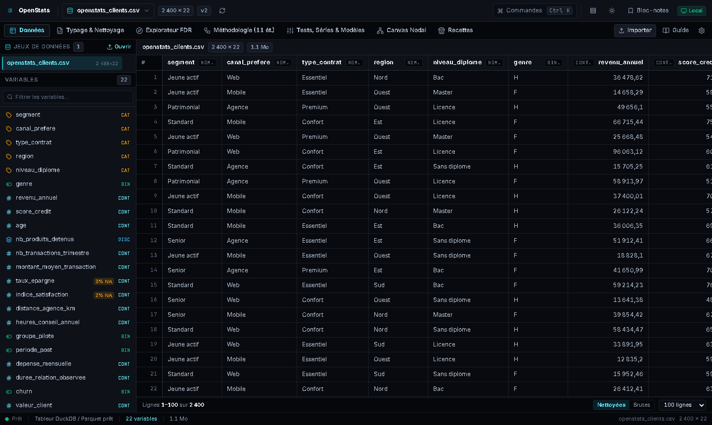
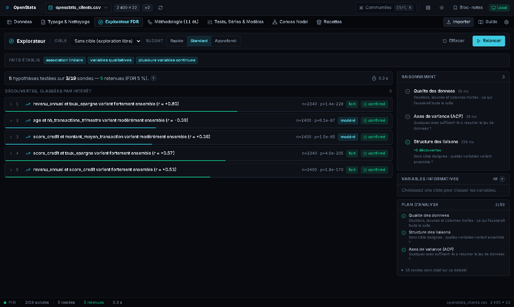
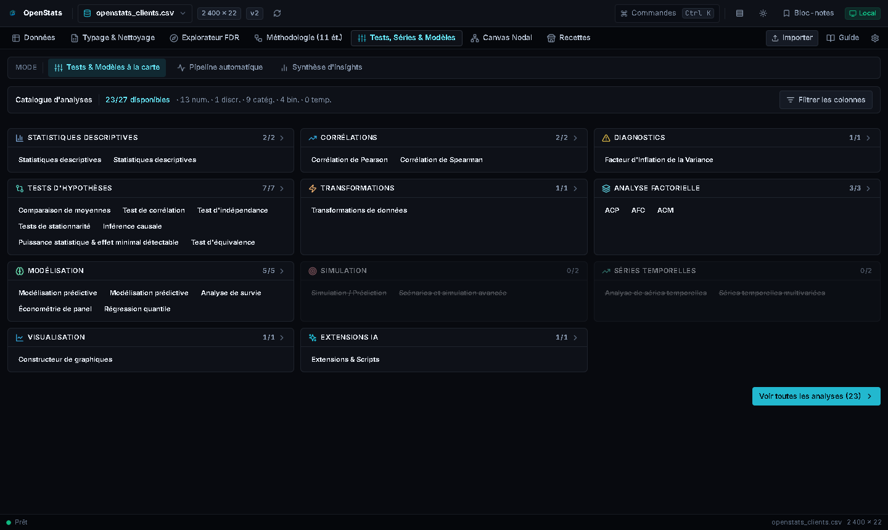
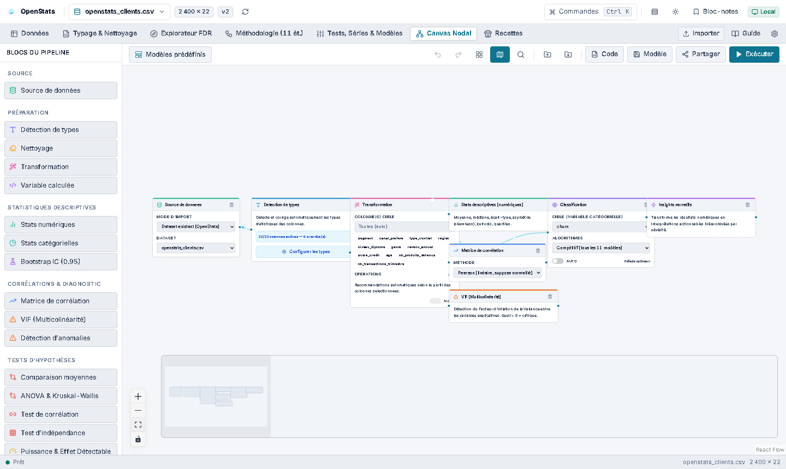

<div align="center">

# OpenStats

**Local-first statistical analysis, econometrics, and machine learning studio.**  
*Zero cloud lock-in. DuckDB speed. Publication-grade plots. Python, R & Jupyter export.*

[](README.md)
[](README.fr.md)
[](https://github.com/elm-as/OpenStats/releases/tag/v1.0.0-rc.1)
[](https://github.com/elm-as/OpenStats/releases/latest)
[](#license)

[**Download Windows Installer (`OpenStats_Setup_v1.0.0-rc.1.exe`)**](https://github.com/elm-as/OpenStats/releases/latest) · [**User Guide (FR)**](docs/USER_GUIDE.md) · [**Technical Architecture (FR)**](docs/TECHNICAL_ARCHITECTURE.md)

<br/>



</div>

---

## Why OpenStats?

Most tools force a trade-off between point-and-click simplicity (SPSS, Jamovi) and analytical depth (Python, R). **OpenStats gives you both on your own hardware — with zero telemetry and zero account required.**

- **Self-Correcting 11-Step Methodology** — Diagnoses skewness, outliers, missingness, and leakage, tests remediations, **automatically rolls back fixes that worsen quality**, and benchmarks 15 ML + 6 forecasting models against a **naïve baseline**.
- **Session-Wide FDR Control** — The Adaptive Explorer ranks relationships by mutual information and applies **Benjamini-Hochberg (5% FDR)** across every test run so chance correlations aren't sold as findings.
- **Publication-Grade Visuals (Dark & Light)** — Okabe-Ito colorblind-safe palette, Forest Plots (`coefplot` β ± 95% CI), Kaplan-Meier survival curves, Love Plots, VAR/IRF grids, and 3× HD PNG / SVG / CSV export.
- **Visual Canvas -> Real Code** — Wire DuckDB SQL, cleaning, econometric models, and Python scripts visually, then export topologically ordered **`.py`**, **`.R`**, **`.ipynb`**, **PDF**, **DOCX**, or **PPTX**.
- **Standalone Windows Desktop App** — Ships as a single Electron + PyInstaller installer (`OpenStats_Setup_v1.0.0-rc.1.exe`) with Python, DuckDB, Scikit-Learn, XGBoost, LightGBM, Statsmodels, and SHAP bundled inside.

---

## Interface Tour

<table>
  <tr>
    <td width="50%">
      
      <p align="center"><b>Data Workbench</b> — Live DuckDB/Parquet grid, variable dock, semantic types & dataset versions.</p>
    </td>
    <td width="50%">
      
      <p align="center"><b>Adaptive Explorer</b> — Probe-driven discovery with transparent Benjamini-Hochberg 5% FDR accounting.</p>
    </td>
  </tr>
  <tr>
    <td width="50%">
      
      <p align="center"><b>Statistical & Econometric Studio</b> — Hypothesis tests, TOST, power, OLS/Panel/Quantile, PCA/CA/MCA, ARIMA/VAR.</p>
    </td>
    <td width="50%">
      
      <p align="center"><b>Nodal Canvas (Light & Dark)</b> — Drag-and-drop analytical pipelines with one-click Python, R & Notebook export.</p>
    </td>
  </tr>
</table>

---

## What's Included

| Domain | Capabilities |
|---|---|
| **Data & SQL** | CSV, multi-sheet Excel, JSON/JSONL, Parquet (magic-byte validated), embedded **DuckDB SQL**, dataset versioning & rollback |
| **Hypothesis & Power** | Shapiro-Wilk, Student/Welch t, Mann-Whitney, ANOVA, Kruskal-Wallis, Tukey HSD, Games-Howell, Chi², Fisher, **TOST equivalence**, **MDE & sample-size power** |
| **Econometrics & Causality** | Robust OLS (HC1/HC3), VIF & residual diagnostics, Quantile regression, Poisson / NegBin, **Panel FE/RE + Hausman**, **Kaplan-Meier & Cox PH**, **PSM + Love Plot, Diff-in-Diff, 2SLS** |
| **Time Series** | ADF/KPSS stationarity, seasonal decomposition, **ARIMA, SARIMA, Prophet, Holt-Winters**, **VAR, VECM, ARDL, BVAR, Johansen, Granger, IRF & FEVD** |
| **Factor Analysis & ML** | PCA, CA, MCA (biplots, correlation circles, scree), 15 supervised ML classifiers/regressors, K-Means/DBSCAN, **SHAP explainability**, Monte Carlo & Bootstrap |
| **Export & Reporting** | Autonomous **Python (`.py`)**, **R (`.R`)**, **Jupyter (`.ipynb`)**, **PDF (ReportLab)**, **Word (DOCX)**, **PowerPoint (PPTX)**, **Excel** |

---

## Quick Start

### Option 1 — Windows Desktop Installer (Recommended)

Download and run **`OpenStats_Setup_v1.0.0-rc.1.exe`** from [**GitHub Releases**](https://github.com/elm-as/OpenStats/releases/latest). No Python or Node.js installation required.

### Option 2 — Run from Source

```bash
git clone https://github.com/elm-as/OpenStats.git && cd OpenStats

# Terminal 1 — Python Analytics Backend (Python 3.10+)
cd backend && python -m venv venv && venv\Scripts\activate
pip install -r requirements.txt && python run.py

# Terminal 2 — React + Vite Frontend (Node 18+)
cd frontend && npm install && npm run dev
```

<details>
<summary><b>Build Desktop Installer & Run Verification Suites</b></summary>

```bash
# Build PyInstaller backend + Electron + Inno Setup installer -> frontend/release/OpenStats_Setup_v1.0.0-rc.1.exe
python scripts/build_installer.py --rebuild-backend

# Run quality & test suites
cd backend && python -m pytest tests -p no:qt -q
cd frontend && npx tsc -b && npx vitest run
python scripts/check_line_counts.py   # ElmasCore strict <= 350 lines/file check
```

</details>

---

## Statistical Guarantees & Scope

OpenStats explicitly documents both what is test-verified and what its boundaries are (full details in [`ARCHITECTURE.md`](ARCHITECTURE.md)):

| Guarantee / Boundary | Status |
|---|---|
| **Rollback on zero-gain fixes** | Verified in pipeline loop: harmful or ineffective remedies are reverted automatically |
| **Protected target variable** | Target column cannot be dropped during remediation or selection |
| **Baseline comparison** | Every ML & forecasting score is benchmarked against a naïve reference |
| **No swallowed errors** | 61 AST tests forbid bare `except Exception` in statistical engines (`statistical_attempt.py`) |
| **Local execution boundary** | Custom Python node uses local `exec()`; designed for single-user desktop/local use, not public multi-tenant hosting |
| **Generated code parity** | Exported Python executes in subprocess tests across 26 node types (max numeric drift `8.88e-16`); R generator is structurally validated |

---

<details>
<summary><b>Documentation & Engineering Standards (ElmasCore)</b></summary>

- [**User Guide (`docs/USER_GUIDE.md`)**](docs/USER_GUIDE.md) — Complete workspace & statistical methods manual (FR)
- [**Technical Architecture (`docs/TECHNICAL_ARCHITECTURE.md`)**](docs/TECHNICAL_ARCHITECTURE.md) — IPC, session tokens, DuckDB zero-copy, PyInstaller/Inno Setup pipeline (FR)
- [**Desktop Build Guide (`DESKTOP_GUIDE.md`)**](DESKTOP_GUIDE.md) — Windows packaging instructions (FR)
- [**Analysis Engines Design (`ARCHITECTURE.md`)**](ARCHITECTURE.md) & [**Engineering Charter (`ELMAS.md`)**](ELMAS.md) — Strict domain layering & 350-line file ceiling

</details>

## License

Released under **AGPLv3** — local-first, open-source, no paywall, no forced cloud uploads.

<div align="center">
  <sub><b>ELMAS CORE LABORATORY</b> — <i>"From Data to Systems"</i></sub>
</div>
